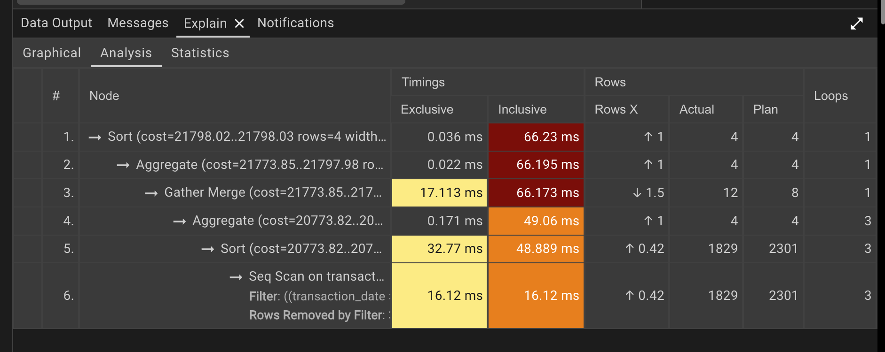
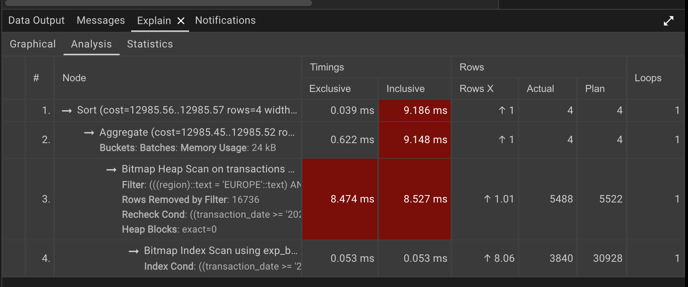
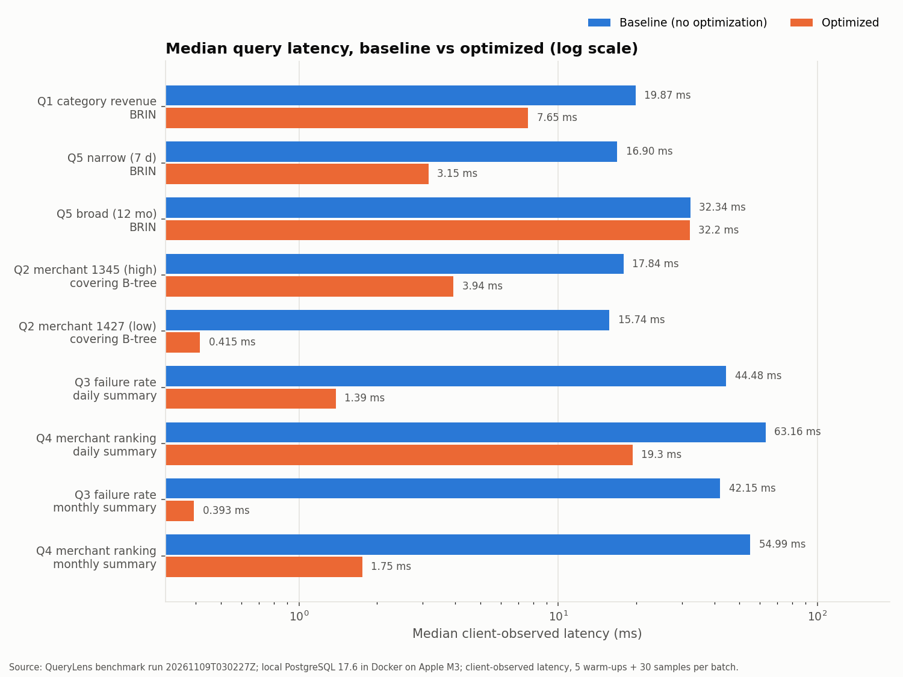

# QueryLens

A small SQL query optimization experiment using PostgreSQL.

## Why I built this

When a SQL aggregation query is slow, my first instinct used to be "add an index" or
"partition the table." I wanted to understand what actually happens inside the database when
an analytical query runs, so I set up a small experiment: read the execution plan first, then
change one thing at a time and measure.

## What I tried

- **1 million synthetic e-commerce transactions** (fixed seed) in a local PostgreSQL 17 database.
- A few analytical queries that filter by date, merchant, region and status, then aggregate.
- `EXPLAIN (ANALYZE, BUFFERS)` to see what each query actually did.
- A **BRIN index**, a **covering B-tree index** and **pre-aggregated summary tables**, each
  checked to return exactly the same result as the original query.

## Following the query plan

The main example is a one-week revenue query ([`sql/baseline/q5_narrow.sql`](sql/baseline/q5_narrow.sql)):

```sql
SELECT payment_method, COUNT(*), SUM(amount), ROUND(AVG(amount), 2)
FROM transactions
WHERE transaction_date >= '2026-10-01' AND transaction_date < '2026-10-08'
  AND region = 'EUROPE' AND status = 'SUCCESS'
GROUP BY payment_method;
```

**What the plan showed.** A parallel sequential scan of the whole table. PostgreSQL scanned all
**12,386 heap pages** and threw away 994,512 of the 1,000,000 rows to return 5,488. Its row
estimate was accurate (5,522), so it wasn't confused. Without a suitable date-range index, PostgreSQL
chose a sequential scan, even though the query only needed one week of data.

**The idea.** The transactions were inserted in timestamp order, so the table is physically
sorted by time (`pg_stats.correlation` = 1.0 for `transaction_date`). A BRIN index stores just
the min and max timestamp for each block of 128 pages. That should let PostgreSQL skip blocks
that can't contain the week I asked for.

**What changed.** With a 48 kB BRIN index, the plan became a Bitmap Index Scan feeding a Bitmap
Heap Scan. PostgreSQL skipped the page ranges that couldn't contain the week, but because BRIN is
lossy it still rechecked every candidate row in the ranges it kept. It read **386 pages instead
of 12,386**, and the median latency went from **16.90 ms to 3.15 ms
(about 5.4×)**.

Here is the same query in pgAdmin's EXPLAIN ANALYZE view, one representative run before and
after creating the index:

**Before BRIN: sequential scan**



**After BRIN: Bitmap Index Scan + Bitmap Heap Scan**



Before the index, PostgreSQL scanned the whole table and filtered out almost every row. After it,
the Bitmap Index Scan picked out only the block ranges that could hold the requested week, and
the Bitmap Heap Scan read just those pages. The timings in the screenshots come from single runs
in pgAdmin, so they differ from the repeated-benchmark medians above.

**The broad query didn't benefit.** The same query over the full 12 months matches every block,
so there is nothing to skip. PostgreSQL ignored the index and kept the sequential scan
(32.34 ms vs 32.17 ms), which was the right choice. The one-month category query
([`q1`](sql/baseline/q1_category_revenue.sql)) landed in between: 19.87 → 7.65 ms.

## Other things I tested

| Query | What I tried | Median before → after | Extra storage | Trade-off |
|---|---|---|---|---|
| Revenue for one merchant (largest / smallest) | Covering B-tree `(merchant_id, status) INCLUDE (region, amount)` | 17.84 → 3.94 ms / 15.74 → 0.415 ms | 51 MB (about half the table) | Index-only scan works only while pages are marked all-visible; every insert also updates this index (write cost not measured) |
| Failure rate by region, 6 months | Daily summary table | 44.48 → 1.39 ms | 1.4 MB | Summary must be refreshed; late events and refunds must update it |
| Top 20 merchants | Daily vs monthly summary table | 63.16 → 19.34 ms / 54.99 → 1.75 ms | 16.4 MB / 1.3 MB | Daily grain still had 227k rows to aggregate; monthly can't answer partial-month windows |

## Results



Local benchmark on synthetic data (Docker on a laptop, data fully cached). Each bar is a median
of 60–90 executions, with baseline batches before and after each optimized batch, and every
result matched the baseline. Log scale, because values span 0.4–60 ms. Raw numbers:
[`comparisons.csv`](benchmarks/results/validated/20261109T030227Z/comparisons.csv).

## Run it yourself

Needs Docker and Python 3.11+. PostgreSQL is exposed on `localhost:5433`.

```bash
scripts/setup.sh
```

This creates `.env` from `.env.example`, starts PostgreSQL, installs the requirements into
`.venv`, loads the 1M rows and validates them. To look at a plan, add the BRIN index, look
again, then remove it:

```bash
{ echo "EXPLAIN (ANALYZE, BUFFERS)"; cat sql/baseline/q5_narrow.sql; } | docker compose exec -T postgres psql -U txlab -d txlab
```

```bash
docker compose exec -T postgres psql -U txlab -d txlab -c "CREATE INDEX exp_brin_txn_date_ppr128 ON transactions USING brin (transaction_date);"
```

```bash
{ echo "EXPLAIN (ANALYZE, BUFFERS)"; cat sql/baseline/q5_narrow.sql; } | docker compose exec -T postgres psql -U txlab -d txlab
```

```bash
docker compose exec -T postgres psql -U txlab -d txlab < sql/experiments/cleanup.sql
```

To compare the graphical plans in pgAdmin instead, step through
[`sql/experiments/pgadmin_brin_walkthrough.sql`](sql/experiments/pgadmin_brin_walkthrough.sql).

The comparison script creates each optimization, measures it, checks the results match, and drops
it again:

```bash
.venv/bin/python benchmarks/run_benchmarks.py --smoke
```

`--smoke` takes about 7 seconds; the full run takes about a minute.
`benchmarks/run_baseline.py` saves plans for all baseline queries. `docker compose down` stops
the database (`-v` also deletes its data).

## What I learned

- **Read the plan before optimizing.** The plan showed exactly where the time went: reading
  every page, not a bad estimate or an expensive sort.
- **An index only helps if it lets the database skip work.** BRIN helped the one-week query
  and did nothing for the full year. The same covering index saved much more for a small
  merchant than a large one.
- **Every speedup has a cost.** Storage (51 MB for the covering index), write overhead, and,
  for summary tables, freshness and maintenance.
- **One fast run doesn't prove much.** Batch medians for the same query sometimes differed by
  more than 50%, depending on what else my laptop was doing. Running baseline batches before
  and after each change made the comparisons much more trustworthy.

## Limitations

Local PostgreSQL in Docker on one laptop, synthetic and perfectly time-ordered data, a table
small enough to sit in memory, a single client, and no measurement of insert overhead or
production-like workloads. The numbers show what happened here, not what would happen in
production.

Development note: I used Claude Code to help with synthetic data generation, benchmarking
utilities, and documentation cleanup. The focus of this project was exploring SQL execution
plans, testing optimization approaches, and understanding the trade-offs.
